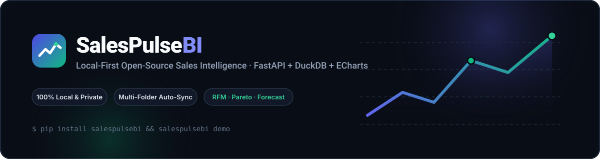
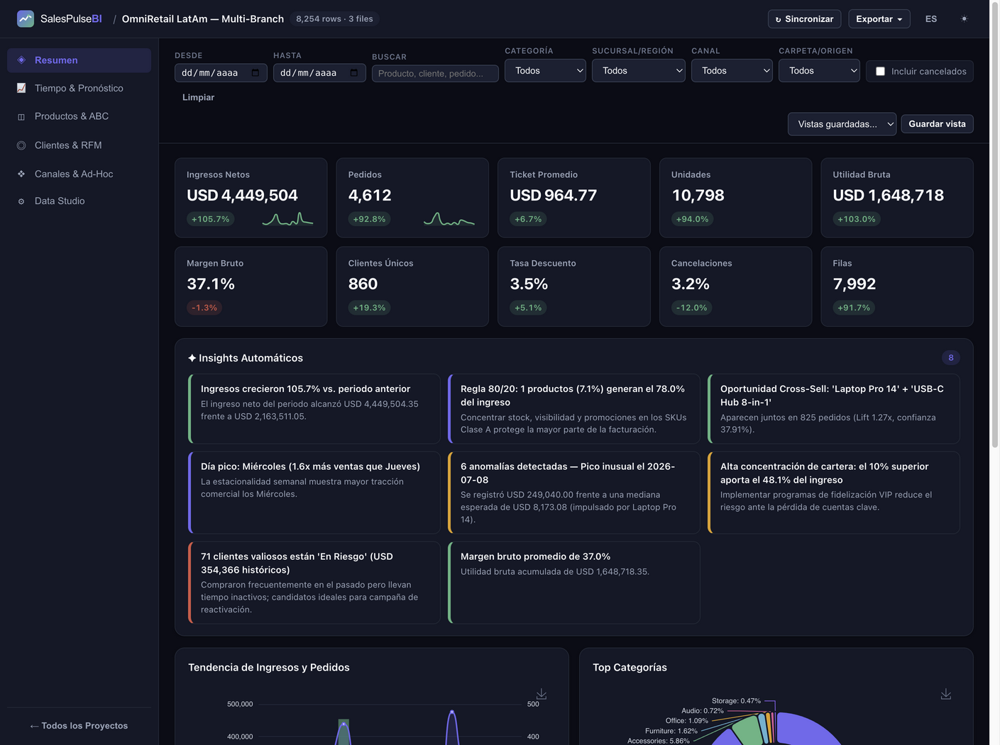
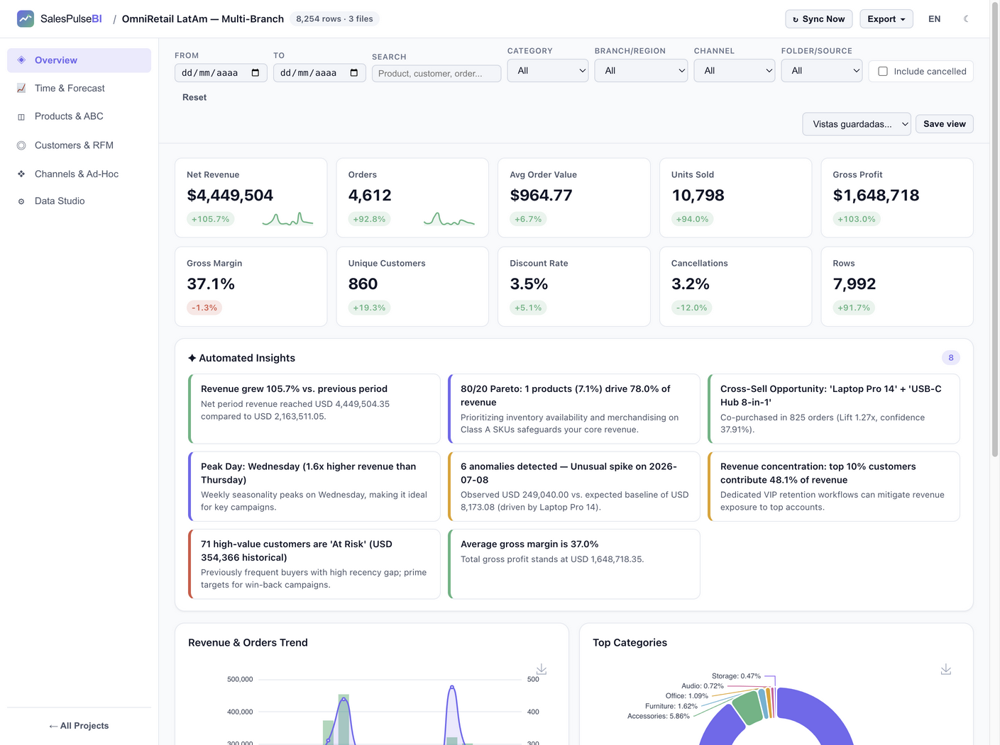
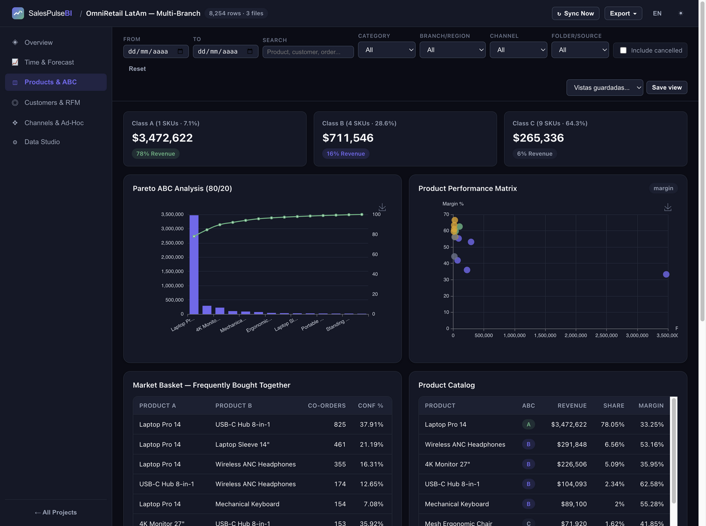
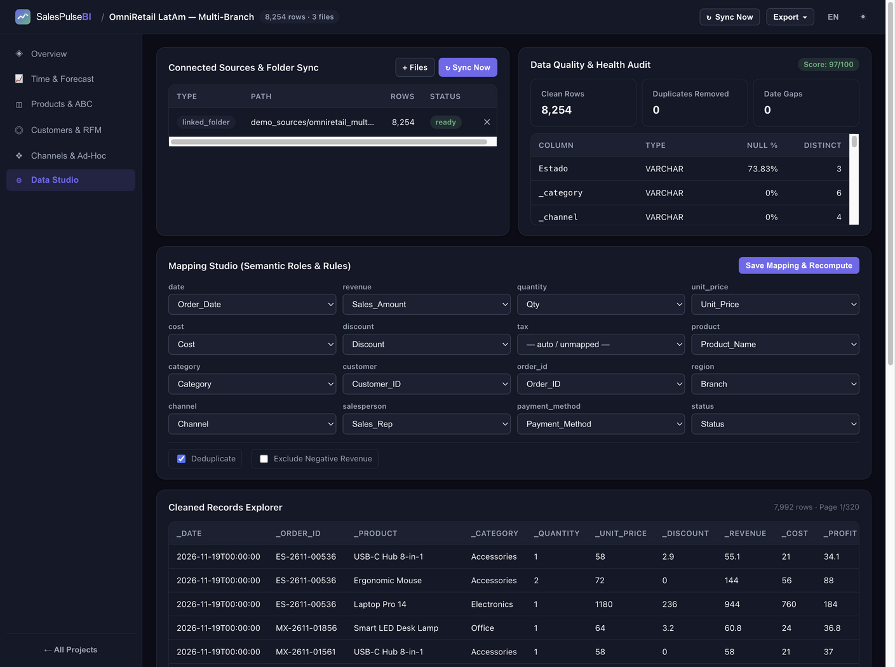

<div align="center">

<picture>
  <source media="(prefers-color-scheme: dark)" srcset="docs/assets/banner-dark.svg" />
  <source media="(prefers-color-scheme: light)" srcset="docs/assets/banner-light.svg" />
  
</picture>

<br />

**Convierte hojas de cálculo, exportaciones de ventas o carpetas completas multi-sucursal en un dashboard BI local, privado e interactivo en segundos.**

[**English**](README.md) · [**Español**](README.es.md)

<p>
  
  
  
  
  
  
</p>

</div>

---

## ¿Por qué SalesPulseBI?

| Característica | **SalesPulseBI** | Herramientas BI Cloud | Notebooks Ad-Hoc |
| :--- | :---: | :---: | :---: |
| **100% Local y Privado** (sin subir datos a la nube, funciona offline) | ✅ | ❌ | ⚠️ |
| **Ingiere carpetas completas** con encabezados y formatos heterogéneos | ✅ | ⚠️ | ❌ |
| **Proyectos Persistentes** (SQLite + Parquet DuckDB + Sync) | ✅ | ✅ | ❌ |
| **Analítica Adaptativa** (funciona desde 2 columnas hasta 20+) | ✅ | ❌ | ❌ |
| **Pronóstico, Anomalías MAD, Pareto ABC, RFM y Cohortes integrados** | ✅ | ⚠️ (de pago) | ⚠️ (manual) |
| **Sin Node.js ni servidores de base de datos externos** | ✅ | ❌ | ✅ |

---

## Galería Visual

<table>
  <tr>
    <td width="50%">
      <strong>Resumen Ejecutivo (Modo Oscuro)</strong><br />
      
    </td>
    <td width="50%">
      <strong>Resumen Ejecutivo (Modo Claro)</strong><br />
      
    </td>
  </tr>
  <tr>
    <td width="50%">
      <strong>Pareto ABC de Productos, Matriz y Market Basket</strong><br />
      
    </td>
    <td width="50%">
      <strong>Data Studio, Sincronización de Carpetas y Mapping</strong><br />
      
    </td>
  </tr>
</table>

---

## Inicio Rápido en 30 Segundos

### 1. Instalación

```bash
git clone https://github.com/salespulsebi/salespulsebi.git
cd salespulsebi
python3 -m venv .venv
source .venv/bin/activate
pip install -e ".[xls]"
```

### 2. Inicia con los Proyectos Demo Incluidos

```bash
salespulsebi demo
```

Esto crea dos proyectos de demostración (`OmniRetail LatAm — Multi-Branch` con carpeta multi-sucursal heterogénea CSV + Excel multi-hoja + CSV europeo con `;`, y `Café Aurora — Minimal CSV`) y abre `http://127.0.0.1:8420`.

### 3. Abre tus Propios Archivos o Carpetas de Ventas Directo desde Terminal

```bash
# Apunta directo a cualquier archivo o carpeta con subcarpetas de ventas:
salespulsebi open ./mi_carpeta_ventas --name "Ventas 2026" --currency MXN

# O abre el gestor de proyectos local:
salespulsebi serve
```

### Docker

```bash
docker compose up --build
# Abre http://127.0.0.1:8420
```

---

## Capacidades Principales

### Ingesta Multi-Formato y de Carpetas Heterogéneas
- **Formatos soportados:** `.csv`, `.tsv`, `.txt` (detección automática de delimitador y encoding), `.xlsx` / `.xls` (multi-hoja), `.json`, `.jsonl` / `.ndjson` y `.parquet`.
- **Alineación automática de esquemas:** Si una sucursal exporta `Fecha_Venta, Importe_Total` (`$1,234.56`) y otra exporta `Order_Date, Sales_Amount` o `1.234,56 €` con `;`, SalesPulseBI detecta los roles semánticos bilingües (ES/EN), limpia monedas y fechas mixtas, y unifica todo en un único `dataset.parquet`.
- **Sincronización Incremental en 1 Clic:** Vincula carpetas locales con el explorador visual integrado y presiona **Sincronizar** cuando lleguen nuevos archivos.

### Dashboard Adaptativo de 6 Vistas
Extrae el máximo valor analítico posible según las columnas detectadas en tus datos:

| Columnas Disponibles | Módulos y Métricas Desbloqueadas |
| :--- | :--- |
| **Cualquier archivo tabular** | Score de Calidad (`0–100`), perfilado de columnas, Explorador de registros y **Explorador Ad-Hoc dinámico** |
| **Ingresos** (o `Precio × Cantidad`) | Ingreso Neto, Ticket Promedio (AOV), percentiles (`P25/P50/P75/P90/P99`), histograma de tickets |
| **+ Fecha** | Tendencias (`día/semana/mes/trimestre/año`), media móvil, acumulado YoY, **Heatmap de Estacionalidad**, **Pronóstico Holt-Winters** (bandas `80%/95%`), **Detección de Anomalías MAD** con causa raíz |
| **+ Costo / Descuento / Estatus** | Utilidad Bruta, Margen Bruto %, impacto de descuentos por tramo, tasa de cancelación % |
| **+ Producto / Categoría** | **Pareto ABC (80/20)**, **Matriz BCG**, distribución por categoría |
| **+ ID de Pedido** | Conteo real de órdenes, **Market Basket / Cross-Sell** (`Soporte`, `Confianza`, `Lift`) |
| **+ Cliente** | **Segmentación RFM** (`Champions`, `Loyal`, `At Risk`, etc.), **Nuevos vs. Recurrentes**, **Matriz de Cohortes**, concentración Top `1%/5%/10%` |
| **+ Sucursal / Canal / Vendedor / Pago** | Comparativos operativos con filtros cruzados interactivos + comparativo por carpeta/archivo |

### Proyectos Persistentes, UI Bilingüe y Exportaciones
- **Proyectos persistentes** en `~/.salespulsebi/` con vistas guardadas, duplicación y exportación/importación portable en `.zip`.
- **Interfaz 100% bilingüe (ES / EN)** y **Modo Oscuro / Claro** sin CDNs externos.
- **Exportaciones en 1 clic:** Reporte Ejecutivo HTML5 imprimible a PDF, Excel multi-hoja (`.xlsx`), CSV limpio y Parquet.

---

## Contribuciones y Licencia

¡Las contribuciones son bienvenidas! Consulta [CONTRIBUTING.md](CONTRIBUTING.md), [CODE_OF_CONDUCT.md](CODE_OF_CONDUCT.md) y [SECURITY.md](SECURITY.md).

Publicado bajo la [Licencia MIT](LICENSE).
