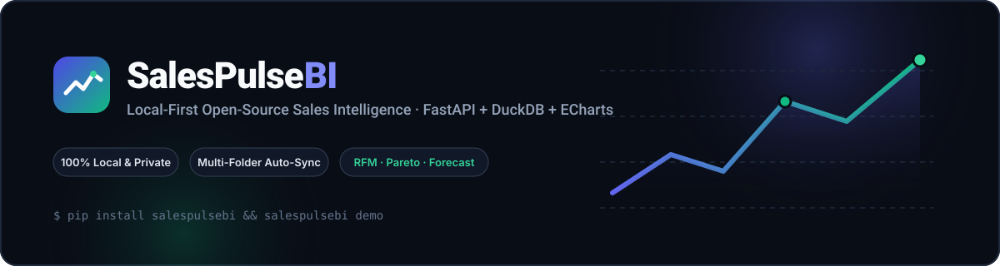
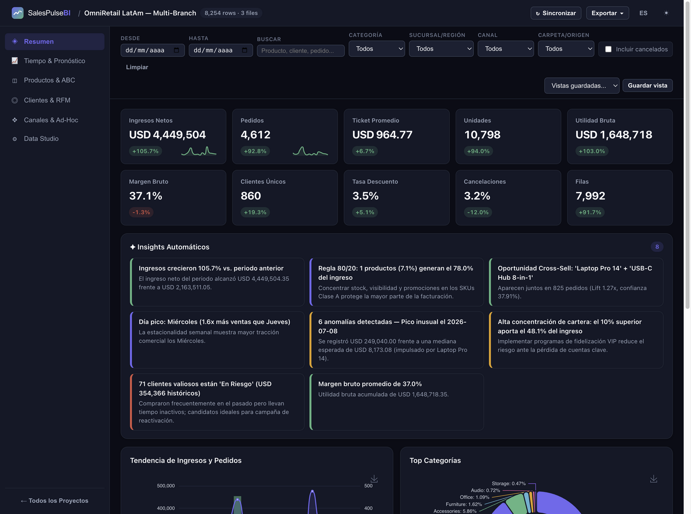
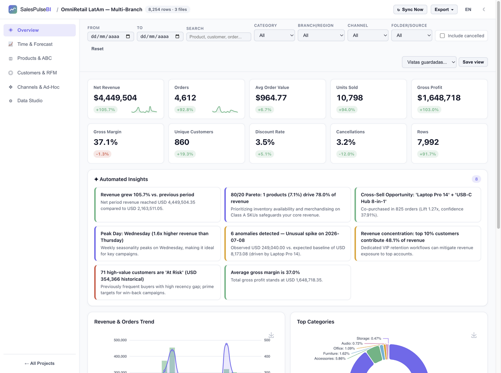
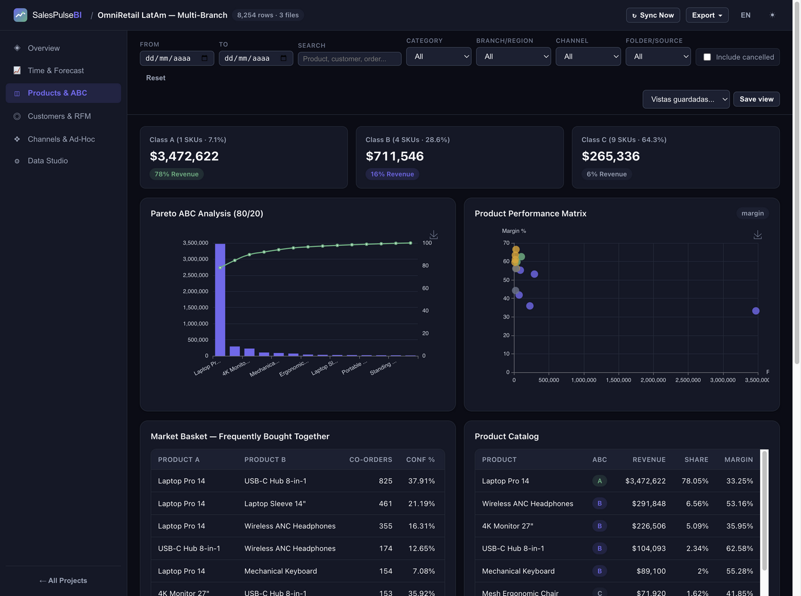
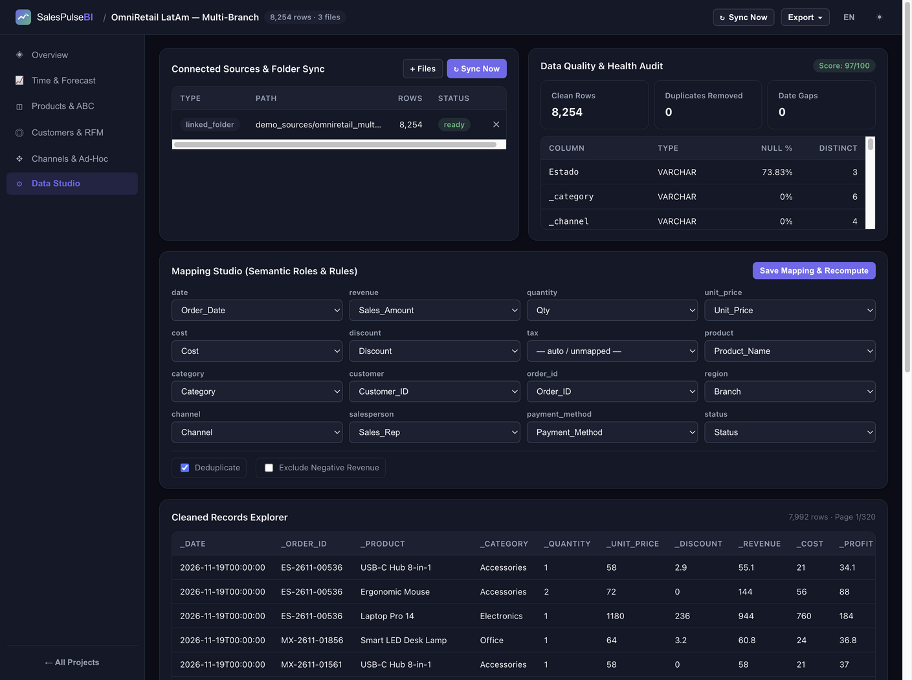
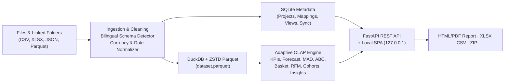

<div align="center">

<picture>
  <source media="(prefers-color-scheme: dark)" srcset="docs/assets/banner-dark.svg" />
  <source media="(prefers-color-scheme: light)" srcset="docs/assets/banner-light.svg" />
  
</picture>

<br />

**Turn raw sales spreadsheets, exports, or entire multi-branch folders into a rich, private, interactive BI workspace — in seconds.**

[**English**](README.md) · [**Español**](README.es.md)

<p>
  
  
  
  
  
  
</p>

</div>

---

## Why SalesPulseBI?

| Feature | **SalesPulseBI** | Cloud BI Tools | Ad-Hoc Notebooks |
| :--- | :---: | :---: | :---: |
| **100% Local & Private** (zero cloud uploads, offline-ready) | ✅ | ❌ | ⚠️ |
| **Ingests entire folders** with heterogeneous headers & formats | ✅ | ⚠️ | ❌ |
| **Persistent Projects** (SQLite + DuckDB Parquet + Sync) | ✅ | ✅ | ❌ |
| **Adaptive Analytics** (works with 2 columns or 20+ columns) | ✅ | ❌ | ❌ |
| **Built-in Forecast, MAD Anomalies, Pareto ABC, RFM & Cohorts** | ✅ | ⚠️ (paid/plugins) | ⚠️ (manual) |
| **Zero Node.js or database server setup** | ✅ | ❌ | ✅ |

---

## Visual Tour

<table>
  <tr>
    <td width="50%">
      <strong>Executive Overview (Dark Mode)</strong><br />
      
    </td>
    <td width="50%">
      <strong>Executive Overview (Light Mode)</strong><br />
      
    </td>
  </tr>
  <tr>
    <td width="50%">
      <strong>Product Pareto ABC, Matrix & Market Basket</strong><br />
      
    </td>
    <td width="50%">
      <strong>Data Studio, Folder Sync & Mapping</strong><br />
      
    </td>
  </tr>
</table>

---

## 30-Second Quickstart

### 1. Install

```bash
git clone https://github.com/salespulsebi/salespulsebi.git
cd salespulsebi
python3 -m venv .venv
source .venv/bin/activate
pip install -e ".[xls]"
```

### 2. Launch with Built-In Demo Projects

```bash
salespulsebi demo
```

This seeds two showcase projects (`OmniRetail LatAm — Multi-Branch` across heterogeneous CSV + multi-sheet XLSX + European `;` CSV folders, and `Café Aurora — Minimal CSV`) and opens `http://127.0.0.1:8420`.

### 3. Open Your Own Sales File or Folder Immediately

```bash
# Point directly to any sales CSV, Excel workbook, or nested folder:
salespulsebi open ./my_sales_folder --name "Retail 2026" --currency USD

# Or start the empty local workspace hub:
salespulsebi serve
```

### Docker

```bash
docker compose up --build
# Open http://127.0.0.1:8420
```

---

## Key Capabilities

### Multi-Format & Folder Ingestion
- **Supported formats:** `.csv`, `.tsv`, `.txt` (auto delimiter & encoding detection: `utf-8-sig`, `utf-8`, `cp1252`, `latin-1`), `.xlsx` / `.xls` (multi-sheet), `.json`, `.jsonl` / `.ndjson`, and `.parquet`.
- **Heterogeneous Schema Alignment:** Drop a folder where one branch exports `Fecha_Venta, Importe_Total` (`$1,234.56`) and another exports `Order_Date, Sales_Amount` or European `1.234,56 €` — SalesPulseBI automatically detects bilingual Spanish/English column roles, normalizes currencies & mixed dates, and unifies everything into a single ZSTD-compressed Parquet dataset.
- **1-Click Incremental Folder Sync:** Link local folders via the built-in directory browser and hit **Sync** whenever new daily/monthly files arrive. SHA-256 hashing tracks added, modified, and removed files.

### Adaptive 6-View Dashboard
SalesPulseBI extracts maximum intelligence from whatever columns exist in your dataset:

| Available Columns | Unlocked Modules & Metrics |
| :--- | :--- |
| **Any tabular file** | Data Health Score (`0–100`), column profiling, paginated Data Explorer, dynamic **Ad-Hoc Explorer** |
| **Revenue** (or `Unit Price × Quantity`) | Net Revenue, AOV, percentiles (`P25/P50/P75/P90/P99`), ticket histogram |
| **+ Date** | Granular trends (`day/week/month/quarter/year`), 7-period moving avg, MoM/YoY cumulative curves, **Day×Month Seasonality Heatmap**, **Holt-Winters Statistical Forecast** (`80%/95%` confidence bands), **MAD Z-Score Anomaly Detection** with root-cause attribution |
| **+ Cost / Discount / Status** | Gross Profit, Gross Margin %, Discount Impact tiers (`0%`, `1-10%`, `11-25%`, `>25%`), Cancellation Rate % |
| **+ Product / Category** | **Pareto ABC (80/20)** classification, **BCG Performance Matrix**, category mix donut |
| **+ Order ID** | True distinct order count, **Market Basket / Cross-Sell** affinity (`Support`, `Confidence`, `Lift`) |
| **+ Customer** | **RFM Segmentation** (`Champions`, `Loyal`, `At Risk`, etc.), **New vs. Returning**, **Monthly Cohort Retention Matrix**, Top `1%/5%/10%` revenue concentration |
| **+ Region / Channel / Rep / Payment** | Cross-filterable operational breakdowns + source folder/file comparisons |

### Persistent Projects, Bilingual UI & Exports
- **Persistent Workspaces:** Saved locally under `~/.salespulsebi/` (`metadata.db` + per-project `dataset.parquet`), with saved filter views, project duplication, and portable `.zip` project bundles.
- **Bilingual & Theme-Ready:** Instant **ES / EN** language toggle and **Dark / Light** theme switcher with zero CDN calls (Apache ECharts bundled locally).
- **1-Click Exports:** Printable Executive Report (HTML5/PDF), styled multi-sheet Excel (`.xlsx`), formula-safe CSV, and Parquet.

---

## Architecture



---

## Contributing & License

Contributions are welcome! See [CONTRIBUTING.md](CONTRIBUTING.md), [CODE_OF_CONDUCT.md](CODE_OF_CONDUCT.md), and [SECURITY.md](SECURITY.md).

Released under the [MIT License](LICENSE).
